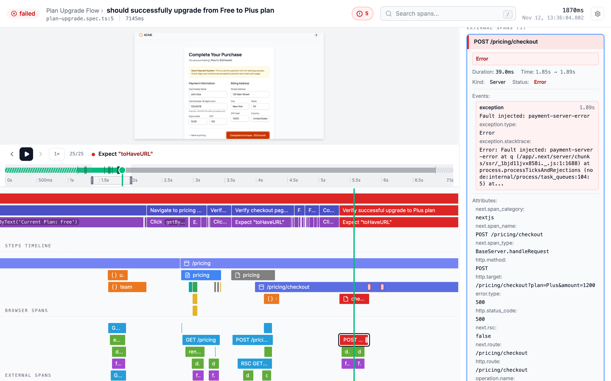
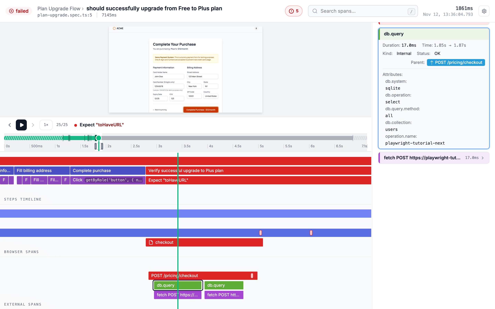

<p align="center">
	<picture>
		<source media="(prefers-color-scheme: dark)" srcset="docs/assets/logo-dark.svg" />
		
	</picture>
</p>

<h1 align="center">Playwright OpenTelemetry</h1>

<p align="center">
	<strong>Trace your Playwright tests across the entire stack.</strong>
</p>

<p align="center">
	<a href="https://www.npmjs.com/package/playwright-opentelemetry"></a>
	<a href="LICENSE"></a>
</p>

<p align="center">
	<a href="#quick-start">Quick start</a> ·
	<a href="#documentation">Documentation</a> ·
	<a href="https://trace.endform.dev/?traceSource=https%3A%2F%2Fdemo-traces.endform.dev%2Fotel-traces%2Fplaywright-tutorial%2Fpayment-server-error%2Fv2.zip">View example trace</a> ·
	<a href="#contributing">Contributing</a>
</p>

---

`playwright-opentelemetry` records a Playwright test as OpenTelemetry spans, captures the browser activity around it, and propagates W3C trace context from browser requests into your instrumented backend. The result is one connected trace, shaped by a named test, that you can view alongside Playwright's screenshot filmstrip.



## Why

A failing end-to-end test shows you everything the browser saw and nothing about why it failed. The real cause is usually beyond the network boundary: an application handler, a failed queue consumer, a database query that never ran.

When the test itself starts a distributed trace, it becomes the root of every instrumented service the user journey touched:

```text
Playwright test
    -> test step
        -> browser request + traceparent
            -> application request
                -> service call
                    -> database query
```

One trace ID connects the failed step to everything that ran beneath it.

## How it works

A trace is produced by three sources of spans:

- The **reporter** turns each retained test attempt into a root `playwright.test` span, with steps, hooks, fixtures, and actions as child spans.
- The **fixture** records browser activity (navigations, requests, console messages, page errors) as spans and injects a W3C `traceparent` header into the requests a test makes: browser requests, `request` calls and `fetch` calls.
- Your **backend spans**: the fixture's reach stops at the browser, but any service already instrumented with OpenTelemetry that honors the propagated `traceparent` header attaches its spans beneath the test automatically.

This repo ships the reporter and fixture, plus tooling for viewing and storing the traces they produce:

| Package                                                   | What it does                                                                                                                                                                                                                                                        |
| --------------------------------------------------------- | ------------------------------------------------------------------------------------------------------------------------------------------------------------------------------------------------------------------------------------------------------------------- |
| [`playwright-opentelemetry`](reporter/)                   | The **reporter** and **fixture** to produce OpenTelemetry traces.                                                                                                                                                                                                   |
| [`@playwright-opentelemetry/trace-viewer`](trace-viewer/) | A **trace viewer** for OpenTelemetry trace data rendered alongside Playwright's screenshot filmstrip: a time-aligned flame graph split into test steps, browser spans, and external (backend) spans. Also [hosted at trace.endform.dev](https://trace.endform.dev). |
| [`@playwright-opentelemetry/trace-api`](trace-api/)       | An **OTLP-compatible Trace API** that makes it easy to store trace data together with the screenshot artifacts, backed by S3-compatible object storage. Deployable to Cloudflare Workers, Deno, Bun, or Node.js.                                                    |



## Quick start

Install the package:

```bash
npm install --save-dev playwright-opentelemetry
```

Add the reporter and choose where the trace data goes in your Playwright config:

```ts
import { defineConfig } from "@playwright/test";
import type {
	PlaywrightOpentelemetryConfig,
	PlaywrightOpentelemetryUseOptions,
} from "playwright-opentelemetry/fixture";

const playwrightOpentelemetry: PlaywrightOpentelemetryConfig = {
	// Send to any OTLP destination, for example, Honeycomb.
	// You can also set the OTEL_EXPORTER_OTLP_ENDPOINT environment variable,
	// which takes precedence over this otlpEndpoint if both are set.
	otlpEndpoint: {
		url: "https://api.eu1.honeycomb.io/v1/traces",
		headers: {
			"x-honeycomb-team": "your-api-key",
		},
	},
	// Or write a local OpenTelemetry trace ZIP instead of, or alongside, OTLP.
	storeTraceZip: true,
};

export default defineConfig<PlaywrightOpentelemetryUseOptions>({
	reporter: [["playwright-opentelemetry/reporter"]],
	use: {
		playwrightOpentelemetry,
		// OpenTelemetry output follows Playwright's trace retention.
		trace: "retain-on-failure",
	},
});
```

Switch your tests to the instrumented fixture:

```ts
import { expect } from "@playwright/test";
import { test } from "playwright-opentelemetry/fixture";

test("has title", async ({ page }) => {
	await page.goto("https://playwright.dev/");

	await expect(page).toHaveTitle(/Playwright/);
});
```

Run your suite, then open the resulting trace ZIP in the [hosted viewer](https://trace.endform.dev). To see the result before configuring anything, [open the example trace](https://trace.endform.dev/?traceSource=https%3A%2F%2Fdemo-traces.endform.dev%2Fotel-traces%2Fplaywright-tutorial%2Fpayment-server-error%2Fv2.zip).

You can also boot the viewer locally:

```bash
npx @playwright-opentelemetry/trace-viewer
```

Two things set the boundary on what you will see. Connected backend spans require services that are already instrumented with OpenTelemetry and honor the propagated trace context. Screenshots are captured by the fixture, so tests need to use its `test`.

## Documentation

- [Configure the reporter](docs/configure-the-reporter.md): OTLP destinations, trace retention, and trace IDs in other reporters
- [Configure the fixture](docs/configure-the-fixture.md): trace context propagation and screenshots
- [View a trace](docs/view-a-trace.md): the hosted and local trace viewer
- [Output formats](docs/output-formats.md): the `opentelemetry-trace.zip` format and the Trace API
- [Deploy your own Trace API](docs/deploy-the-trace-api.md): store and serve traces from S3-compatible storage

## Project status

The project is in early development and still on a `0.x` release, so expect breaking changes between minor versions. The core workflow described above works today: test spans, browser spans, trace propagation, screenshot capture, OTLP export, local ZIPs, the Trace API, and the viewer.

The trace reaches only as far as your instrumentation does. The most useful thing you can tell us is where the trace still goes dark: [open an issue](https://github.com/endformdev/playwright-opentelemetry/issues).

## Contributing

See [CONTRIBUTING.md](CONTRIBUTING.md) for development setup, commands, and the release process.

## License

[Apache-2.0](LICENSE).

Playwright and OpenTelemetry are trademarks of their respective owners. This project is not affiliated with or endorsed by the Playwright or OpenTelemetry projects.

---

<p align="center">Built by</p>
<p align="center">
	<a href="https://endform.dev">
		<picture>
			<source media="(prefers-color-scheme: dark)" srcset="docs/assets/endform-logo-dark.svg" />
			
		</picture>
	</a>
</p>
