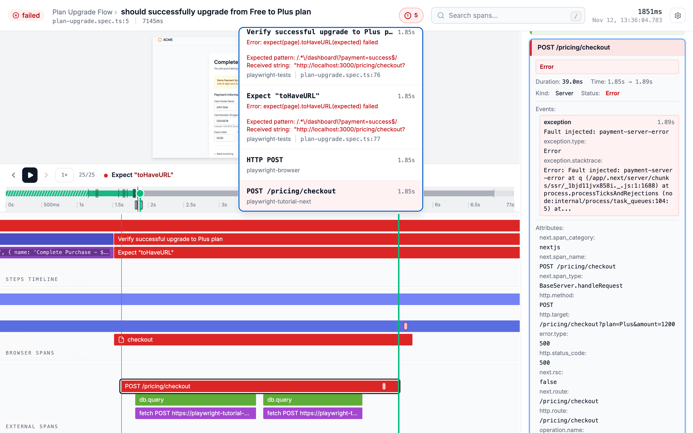

The trace viewer shows a trace ZIP or a [Trace API](output-formats.md#trace-api) URL alongside the test's screenshots.

Open the [example trace](https://trace.endform.dev/?traceSource=https%3A%2F%2Fdemo-traces.endform.dev%2Fotel-traces%2Fplaywright-tutorial%2Fpayment-server-error%2Fv2.zip) to explore a complete failure with connected Playwright, browser, and backend spans, or go to the [hosted trace viewer](https://trace.endform.dev) to load your own trace ZIP.

Or boot your own locally:

```bash
npx @playwright-opentelemetry/trace-viewer
```

This boots the trace viewer on `localhost:9294`. Then load your ZIP file or an API URL responding with telemetry.

The viewer separates the trace into three views that match how you investigate a failure:

- **Test steps** for the Playwright test, hooks, fixtures, and actions. A call on `request`, `page.request` or another `APIRequestContext` is a step that also shows the response it got
- **Browser spans** for navigation, routes, JavaScript, fonts, images, fetches, and other requests
- **External spans** for your instrumented application and backend services

The big screenshot marks what the test did at that moment: a dot where a click landed and an outline around the element it was for, an outline around a field that was filled, a line for a drag, and the same in red for an action that failed. A mark is only drawn on a screenshot known to show the element in that place. Once the page has scrolled or moved on, the screenshots that follow carry none.

Console messages and uncaught browser errors appear as span events on the timeline, and the error navigator jumps straight to failing spans and their recorded exceptions.


