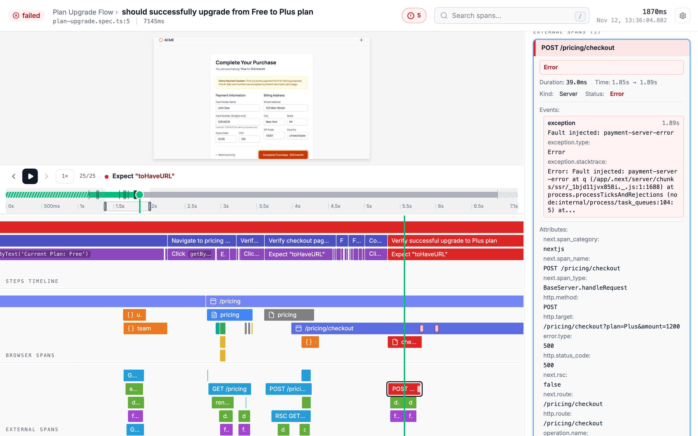

# Playwright OpenTelemetry Trace Viewer

[](https://www.npmjs.com/package/@playwright-opentelemetry/trace-viewer)
[](https://github.com/endformdev/playwright-opentelemetry/blob/main/LICENSE)

A trace viewer designed around tests, part of [Playwright OpenTelemetry](https://github.com/endformdev/playwright-opentelemetry). A hosted copy runs at [trace.endform.dev](https://trace.endform.dev).



## Overview

The viewer reads OpenTelemetry trace data directly rather than a proprietary test-result format. The layout plays the test back above a time-aligned flame graph: a large screenshot of the page (or, chosen in the settings menu, a filmstrip with a row of frames per page), a control bar to step through the test or play it, and a step ruler that scrubs through the whole test and shows a screenshot filmstrip as you hover it. The flame graph below is separated into three views that match how you investigate a failure:

- **Test steps** for the Playwright test, hooks, fixtures, and actions
- **Browser spans** for navigation, routes, JavaScript, fonts, images, fetches, and other requests
- **External spans** for your instrumented application and backend services

Console messages and uncaught browser errors appear as span events on the timeline. You can search span names and attributes, inspect span details and events, jump between errors, and zoom into a time range, while the screenshots stay synchronized with the timeline and grouped by browser context and page.

## Run the trace viewer

To boot the trace viewer on `localhost:9294`:

```bash
npx @playwright-opentelemetry/trace-viewer
```

The viewer can load a local trace zip or a trace-specific API base URL such as `/playwright-otel-trace-viewer/v1/{traceId}`. Remote API loading fetches `{baseUrl}/traces` once for the merged OTLP export, derives test metadata from the root `playwright.test` span, then downloads `{baseUrl}/screenshots.zip` when screenshots are needed.

If the viewer URL includes `traceToken`, the token is propagated to remote Trace API requests as a query parameter:

```text
https://trace.endform.dev/?traceSource=https%3A%2F%2Fexample.com%2Fplaywright-otel-trace-viewer%2Fv1%2F{traceId}&traceToken={token}
```

This loads `{baseUrl}/traces?traceToken={token}` and `{baseUrl}/screenshots.zip?traceToken={token}`.

The token can also be embedded in the `traceSource` URL, or in a Trace API URL entered in the load form. The viewer normalizes those forms back to the canonical top-level `traceToken` query parameter.

The remote API contract is:

- `GET {baseUrl}/traces` returns `{ "resourceSpans": [...] }` or `404` when the trace does not exist
- `GET {baseUrl}/screenshots.zip` returns a ZIP with root `manifest.json` and `screenshots/*`, or `404` when there are no screenshots

The service worker loads the ZIP and exposes internal per-screenshot URLs to the viewer. Where no service worker can run, the page downloads and unpacks the ZIP itself.

## Choose which panels to show

To show only some regions of the viewer, for example when embedding it in an iframe, add a `view` query parameter with a preset:

```text
https://trace.endform.dev/?traceSource=...&view=player
```

| View     | Panels                      |
| -------- | --------------------------- |
| `full`   | Every panel                 |
| `player` | `viewer`, `ruler`           |
| `spans`  | Every panel except `viewer` |

For full control, list the panels yourself with a comma-separated `panels` query parameter. It overrides `view`:

```text
https://trace.endform.dev/?traceSource=...&panels=viewer,ruler,steps
```

| Panel      | Region                                                                                     |
| ---------- | ------------------------------------------------------------------------------------------ |
| `header`   | Top bar with the test name, status, error spans, search, viewer settings, and time readout |
| `ruler`    | Step ruler: the whole test with its steps and hooks, with a screenshot filmstrip on hover  |
| `viewer`   | Step viewer: the big screen or filmstrip, with a bar of step, playback and page controls   |
| `steps`    | Test steps timeline                                                                        |
| `browser`  | Browser spans timeline                                                                     |
| `external` | External spans timeline                                                                    |
| `details`  | Span details sidebar                                                                       |

## Add an action to an embedded player

When embedding the viewer in an iframe, add an `action` query parameter to put a button at the end of the player's control bar. For now the only action is `expand`:

```text
https://trace.endform.dev/?traceSource=...&view=player&action=expand
```

The viewer doesn't run the action itself. Clicking the button posts `{ type: "trace-viewer:action", action: "expand" }` to the embedding page, which decides what to do, for example open a modal holding the same trace in the `full` view. The button doesn't show when the viewer isn't in an iframe.

The message can be sent to any origin, so check who sent it:

```ts
window.addEventListener("message", (event) => {
	if (event.source !== iframe.contentWindow) return;
	if (event.origin !== "https://trace.endform.dev") return;
	if (event.data?.type !== "trace-viewer:action") return;
	if (event.data.action === "expand") openExpandedTrace();
});
```

Without `view` or `panels`, the viewer settings saved in the browser decide what is shown. With them, the URL decides instead: saved settings are ignored for that page, and changes made in the settings menu there are not saved. Unknown panel names are ignored. A `panels` list with no known names falls back to `view`, and an unknown `view` falls back to the saved settings. A listed panel is still hidden when the trace has no data for it. Sections with no data are disabled in the settings menu.

## Embed in a sandboxed iframe

Remote API traces work inside `<iframe sandbox="allow-scripts allow-forms">`, which gives the viewer an opaque origin (`null`) and no service worker. The viewer detects this and needs no configuration, but two things have to be readable from origin `null`:

- The viewer's assets. Served with `Access-Control-Allow-Origin: *` on `/assets/*` by default on Cloudflare (through `public/_headers`) and by `npx @playwright-opentelemetry/trace-viewer`. On any other host, including a custom base path behind a proxy, add that header yourself. Without it the sandboxed page stays blank.
- The Trace API. Set [`corsOrigin: "*"`](../trace-api/README.md) and authorize with `traceToken`, because a sandboxed frame can't send cookies this way.

Local and remote trace ZIPs still need a service worker, so they can't be loaded there.

## Deploy Your Own

### Cloudflare

You can deploy a copy of the trace viewer to Cloudflare:

```bash
git clone https://github.com/endformdev/playwright-opentelemetry.git
cd playwright-opentelemetry/trace-viewer

pnpm install
pnpm build
pnpm deploy
```

### Custom Base Path (Optional)

If you want to build with absolute paths for a specific deployment location:

```bash
VITE_TRACE_VIEWER_BASE=/trace-viewer/ pnpm build
```

## Local Development

```bash
pnpm install
pnpm dev
```
